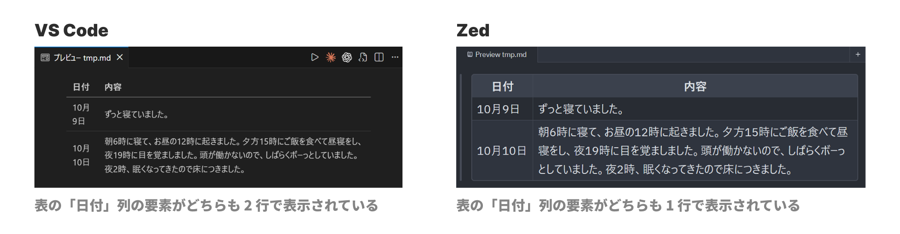

# Markdown Table Line Constraints

[English](./README.md) | 日本語

Markdown Table Line Constraints は、Markdown の表に、列ごとのセルあたりの行数の制約を宣言する記法を導入する提案です。

## 簡単な例示

[GitHub Flavored Markdown](https://github.github.com/gfm/)（GFM）における現状の表では、列幅を宣言的に指定する仕様はなく、描画される列の幅は各レンダラーに任せられています。したがって、以下の画像の左のように、表全体の幅によっては、行の折り返しが発生することで読みにくくなる列を含む場合があります。そこでここでは、以下の画像の右のように、特定の列に対して、**明示的に 1 行での表示を要求する文法**を提案します。


それが、以下のような書き方です。

```md
| 日付 | 内容 |
| :--< | :-- | 
| 10月9日 | ずっと寝ていました。 |
| 10月10日 | 朝6時に寝て、お昼の12時に起きました。夕方15時にご飯を食べて昼寝をし、夜19時に目を覚ましました。頭が働かないので、しばらくボーっとしていました。夜2時、眠くなってきたので床につきました。 | 
```

`:--<` のように、区切り行に `<` を書いた列は、行の折り返しの禁止を要求します。ビューポート幅や表の幅などのやむを得ない制約がある場合を除いて、1 行で表示できるなら 1 行で表示します。

## 現在の状況

以下の表では、`✅`: 完了、`🚧`: 途中、`N/A`: 未着手を意味しています。

|  | 内容 | 仕様の定義 | パーサーの実装 | レンダラーの実装 | 詳細 |
| --: | :-- | :--: | :--: | :--: | :-- |
| v1.0 | `<` による行の折り返し禁止の要求 | 🚧 | N/A | N/A | [docs/v1-0](docs/ja/v1-0.md) |
| v1.1 | `<n` による最大行数の要求 | N/A | N/A | N/A | N/A | 

将来的には `<` だけでなく、`<2` や `<5` などによって任意の行数を指定できるようにしたいです。

今後の計画と具体的な進捗は repo: Roadmap ([#2](https://github.com/otTATto/markdown-table-line-constraints/issues/2)) にまとめています。

## リポジトリの構成

各バージョンごとの詳細は、[`docs/ja/`](docs/ja/) 内に書いています。各バージョンの具体的な仕様は、[`spec/`](spec/) 内にあります。パーサーの実装やレンダラーの実装について、現在詳細は未定です。

## 歴史的な経緯

表の列幅を調整する記法について、例えば、区切り行のハイフン（`-`）の数によって調整したいという要望がありました[^1]。議論の中では、幅はビューポートや表の大きさで決まるもので、パーサーやレンダラーには分からないという内容の指摘や、拡張として実装すべきという指摘がされ、issue は閉じられています。

## 既存のレンダラーにおける表示の違いと問題点

同じ表でも、列幅の決め方はレンダラーによって異なります。VS Code の Markdown プレビューは中身がブラウザであり、列幅はブラウザ標準の表のレイアウトによって決まります[^2]。一方、Zed の Markdown プレビューは独自の UI フレームワークで動いており、表を CSS Grid として描いています[^3]。



どちらの方式にも長所と短所があります。VS Code（ブラウザ標準）の方式は内容の量に応じて各列に幅を分配するため、文章の多い列は読みやすい一方で、短い列が押されて折り返されやすくなります。日本語のようにどの文字の間でも改行できる言語では、この傾向が特に目立ちます。Zed の方式は短い列を優先して 1 行に保ちますが、長い列には余った幅しか渡らず、表示幅が極端に狭い場合は文字が潰れる可能性があります。

ここで重要なのは、どちらの方式も「どの列を 1 行に保つべきか」という**書き手の意図を知り得ない**という点です。

## 根本的な思想

では、書き手はその意図をどう伝えればよいのでしょうか。

Markdown はマークアップ言語なので、文書の内容それ自体がセマンティックに書かれるべきであり、必要以上に描画のされ方や見え方に手出しすべきでないというのは、もっともな意見です。しかし、例えば GFM の区切り行は、すでに `:--:` などの配置（つまり見た目）の情報を持っています。そもそも、誰も読みにくい表は読みたくありません。この提案は、極めてシンプルな追加記法によって、可読性に大きな影響を与えるものだと思っています。

そして、今回の提案は [# 簡単な例示](#簡単な例示) に挙げたような表を、とある記事投稿サイトで見かけた個人的な体験に端を発します。その解決策として、あえて**列幅を直接指定しない**記法にしたことがポイントです。Microsoft Excel のようなリッチな表エディタを想像すると、日付が 2 行に表示されている表を見かけたとき、日付列の列幅を直接大きくしたくなるものです。しかし、Markdown のパーサーは、書き手がどんなエディタを使っているか、読み手がどんなビューアーを使っているかなどを知りません。フォントが極端に大きいかもしれないし、言語によって必要になる幅が異なるかもしれません。そういった状況にも対応するため、「見た目の幅を直接指定する」のではなく、「この列はどのくらい折り返すのが望ましいかを指定する」ほうが、あらゆる状況に適合しうると考えました。

このように私は、書き手にも、パーサーやレンダラーにも、読み手にも易しい、ちょっとしたひと工夫を提供したいのです。

## 本提案における既知の限界や問題

### 前方互換性は保証できない

`<` を使用していない表が従来と同じ見た目になる後方互換性は保証できます。一方で、未対応の GFM パーサーでは `<` 付きの表が、そもそも表として解釈されません。

### 十分な表示幅があるときは効果がわかりにくい

Zed のように短い列を優先して 1 行に保つレンダラーでは、表示幅に余裕があれば `<` が無くても期待どおりに表示されます。本提案の効果が表れるのは、表示幅が足りず、どこかの列を折り返さなければならない場面です。

## ライセンス

MIT。詳細は [LICENSE](./LICENSE) を参照してください。

## 参考文献

- [**GitHub Flavored Markdown は何であって何でないか** - Qiita](https://qiita.com/tk0miya/items/6b81e0e4563199037018)

[^1]: https://github.com/markedjs/marked/issues/266
[^2]: https://github.com/microsoft/vscode/blob/72e9539ed6b7115bae67de36810bf10c3cb0ba47/extensions/markdown-language-features/media/markdown.css#L377-L394
[^3]: https://github.com/zed-industries/zed/blob/56934ec0560bce8929025497411de7f5322fb6ca/crates/markdown/src/markdown.rs#L3033-L3048
